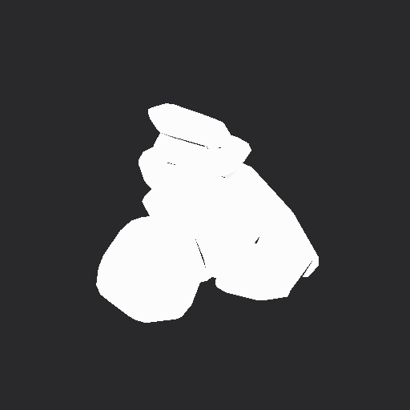

# Rochers_02

`Assets/Prefabs/Camp/Rochers_02.prefab` · [← liste des prefabs](README.md)

Tas de rochers (Nature), au pied de la falaise du camp.



## Hiérarchie

```
Rochers_02
└─ Pièce
   └─ SM_Rock_Pile_03  [MeshFilter, MeshRenderer]
```

## Contenu

### Rochers_02 / Pièce / SM_Rock_Pile_03

- **MeshFilter**
  - maillage `SM_Rock_Pile_03` (`Assets/Synty/PolygonNature/Models/SM_Rock_Pile_03.fbx`)
- **MeshRenderer**
  - matériaux `M_Toon_PolygonNature_01` (Deckscent/Toon)
