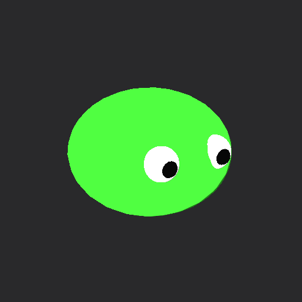

# Slime

`Assets/Prefabs/Enemies/Slime.prefab` · [← liste des prefabs](README.md)

Ennemi simple, en formes simples (aucun slime dans les packs) : un dôme de gelée qui rebondit, deux yeux tournés vers le joueur. Trois sortes (vert 3 PV, rouge 6 PV, bleu 2 d'attaque) réglées par `variant` ; couleur saturée, donc gardée par le post-process (accent). Au tour par tour : attaque le joueur à côté, sinon s'en approche s'il est à moins de `aggroRange` pas. Posé par le Spawner (contenu « monstre »). Voir docs/monstres/slime.md.



## Hiérarchie

```
Slime  [Slime]
└─ Corps
   ├─ Gelée  [MeshFilter, MeshRenderer]
   ├─ Œil_G  [MeshFilter, MeshRenderer]
   │  └─ Pupille  [MeshFilter, MeshRenderer]
   └─ Œil_D  [MeshFilter, MeshRenderer]
      └─ Pupille  [MeshFilter, MeshRenderer]
```

## Contenu

### Slime

- **Slime**
  - `maxHealth` = 3 — Points de vie au départ.
  - `damage` = 1 — Dégâts infligés au joueur par attaque, avant sa défense.
  - `defense` = 0 — Retirée des dégâts reçus. Un coup fait toujours au moins 1.
  - `variant` = Vert — Vert : 3 PV, 1 d'attaque. Rouge : 6 PV. Bleu : 2 d'attaque. Applique la couleur, les PV et l'attaque de la table ci-dessous.
  - `variants` = liste de 3 — Couleur et stats de chaque sorte, dans l'ordre Vert, Rouge, Bleu.
  - `aggroRange` = 6 — Distance (en pas, murs contournés) à laquelle il repère le joueur et le suit. 0 = ne bouge jamais (attaque quand même si on est à côté).
  - `moveTime` = 0.25 — Durée d'un bond ou d'une attaque (secondes).
  - `body` = `Corps` — Le corps qui s'écrase et s'étire (enfant).
  - `jelly` = `Gelée` — Le rendu de la gelée, coloré selon la sorte.
  - `bounceSpeed` = 1.6 — Rebonds par seconde.
  - `squash` = 0.15 — Écrasement / étirement du corps (0 = immobile).
  - `turnSpeed` = 4 — Vitesse à laquelle il se tourne vers le joueur.
  - `hitFlash` = 0.12 — Durée du flash blanc quand il est touché (secondes).

### Slime / Corps / Gelée

- **Transform**
  - position (0, 0.45, 0)
  - échelle (1.2, 0.9, 1.2)
- **MeshFilter**
  - maillage `Sphere` (`Library/unity default resources`)
- **MeshRenderer**
  - matériaux `M_Toon_Slime` (Deckscent/Toon)

### Slime / Corps / Œil_G

- **Transform**
  - position (-0.21, 0.558, 0.492)
  - échelle (0.24, 0.24, 0.24)
- **MeshFilter**
  - maillage `Sphere` (`Library/unity default resources`)
- **MeshRenderer**
  - matériaux `M_Toon_Blanc` (Deckscent/Toon)
  - ombres portées : Off

### Slime / Corps / Œil_G / Pupille

- **Transform**
  - position (0, 0, 0.35)
  - échelle (0.5, 0.5, 0.5)
- **MeshFilter**
  - maillage `Sphere` (`Library/unity default resources`)
- **MeshRenderer**
  - matériaux `M_Toon_Encre` (Deckscent/Toon)
  - ombres portées : Off

### Slime / Corps / Œil_D

- **Transform**
  - position (0.21, 0.558, 0.492)
  - échelle (0.24, 0.24, 0.24)
- **MeshFilter**
  - maillage `Sphere` (`Library/unity default resources`)
- **MeshRenderer**
  - matériaux `M_Toon_Blanc` (Deckscent/Toon)
  - ombres portées : Off

### Slime / Corps / Œil_D / Pupille

- **Transform**
  - position (0, 0, 0.35)
  - échelle (0.5, 0.5, 0.5)
- **MeshFilter**
  - maillage `Sphere` (`Library/unity default resources`)
- **MeshRenderer**
  - matériaux `M_Toon_Encre` (Deckscent/Toon)
  - ombres portées : Off
