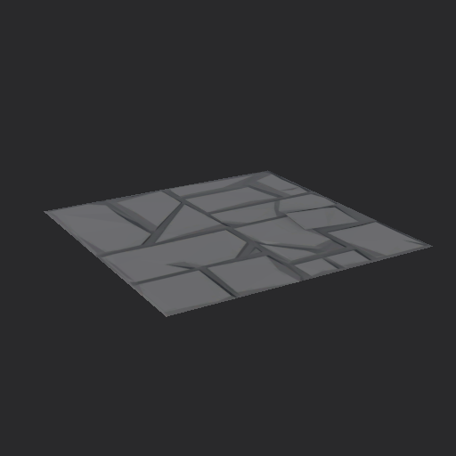

# Sol

`Assets/Prefabs/Maze/Sol.prefab` · [← liste des prefabs](README.md)

Dalle de sol d'une case (Synty `SM_Env_Tiles_Texture_01`), centrée sur la case.



## Hiérarchie

```
Sol
└─ Pièce
   └─ SM_Env_Tiles_Texture_01  [MeshFilter, MeshRenderer]
```

## Contenu

### Sol / Pièce

- **Transform**
  - position (1.5, 0, -1.5)
  - échelle (0.6, 0.6, 0.6)

### Sol / Pièce / SM_Env_Tiles_Texture_01

- **MeshFilter**
  - maillage `SM_Env_Tiles_Texture_01` (`Assets/Synty/PolygonDungeon/Models/SM_Env_Tiles_Texture_01.fbx`)
- **MeshRenderer**
  - matériaux `Textured_Floor_01` (Synty/Generic_Basic)
