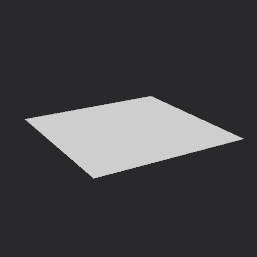

# SolDehors

`Assets/Prefabs/Camp/SolDehors.prefab` · [← liste des prefabs](README.md)

Grand sol d'herbe sous le camp et la forêt (Farm `SM_Generic_Ground_Tile_01`, agrandi).



## Hiérarchie

```
SolDehors
└─ Pièce
   └─ SM_Generic_Ground_Tile_01  [MeshFilter, MeshRenderer]
```

## Contenu

### SolDehors / Pièce / SM_Generic_Ground_Tile_01

- **MeshFilter**
  - maillage `SM_Generic_Ground_Tile_01` (`Assets/Synty/PolygonFarm/Models/SM_Generic_Ground_Tile_01.fbx`)
- **MeshRenderer**
  - matériaux `M_Toon_PolygonFarm_01_A` (Deckscent/Toon)
