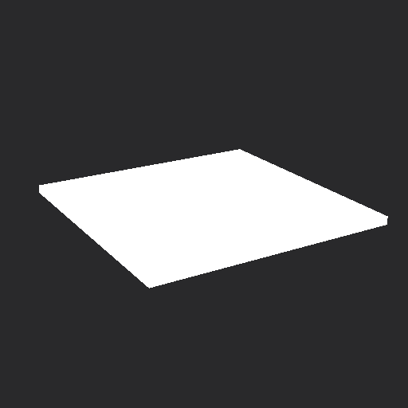

# Sol_Gris

`Assets/Prefabs/Maze/Sol_Gris.prefab` · [← liste des prefabs](README.md)

Sol de secours (bloc gris).



## Hiérarchie

```
Sol_Gris
└─ Forme  [MeshFilter, MeshRenderer]
```

## Contenu

### Sol_Gris / Forme

- **Transform**
  - position (0, -0.05, 0)
  - échelle (3, 0.1, 3)
- **MeshFilter**
  - maillage `Cube` (`Library/unity default resources`)
- **MeshRenderer**
  - matériaux `M_Gris_Sol` (Deckscent/Toon)
