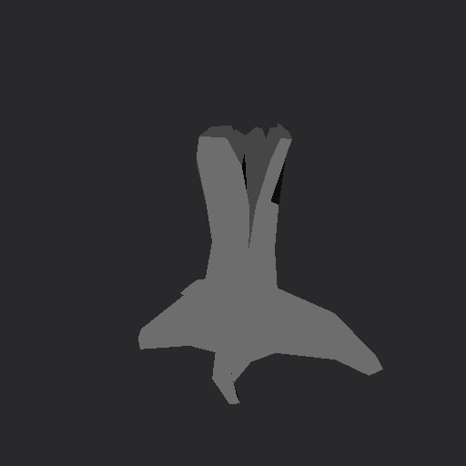

# Souche

`Assets/Prefabs/Camp/Souche.prefab` · [← liste des prefabs](README.md)

Souche (Nature), dehors.



## Hiérarchie

```
Souche
└─ Pièce
   └─ SM_Tree_Stump_02  [MeshFilter, MeshRenderer]
```

## Contenu

### Souche / Pièce / SM_Tree_Stump_02

- **MeshFilter**
  - maillage `SM_Tree_Stump_02` (`Assets/Synty/PolygonNature/Models/SM_Tree_Stump_02.fbx`)
- **MeshRenderer**
  - matériaux `M_Toon_PolygonNature_Tree_Trunk_01` (Deckscent/Toon)
