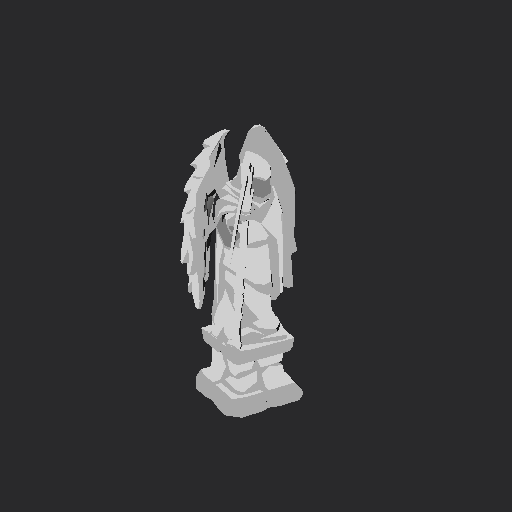

# Statue

`Assets/Prefabs/Props/Decor/Statue.prefab` · [← liste des prefabs](README.md)

Statue (Synty `SM_Env_Statue_01`) dans un coin de salle. Bloque sa case. Voir docs/decor.md.



## Hiérarchie

```
Statue  [DecorFallback, LairDecor]
├─ Décor
│  └─ Pièce
│     └─ SM_Env_Statue_01  [MeshFilter, MeshRenderer]
└─ Secours
   ├─ Socle  [MeshFilter, MeshRenderer]
   └─ Corps  [MeshFilter, MeshRenderer]
```

## Contenu

### Statue

- **DecorFallback**
  - `decor` = `Décor` — La pièce Synty (enfant).
  - `fallback` = `Secours` — La version en formes simples, affichée si le décor n'a pas ses maillages.
  - `forceFallback` = non — Coché : toujours le secours, même si le décor est là (pour comparer).
- **LairDecor**
  - `blocks` = oui — Coché : bloque la case (joueur, monstres, charge). Décoché : décor de passage (ossements au sol…).

### Statue / Décor / Pièce

- **Transform**
  - position (-0.114, 0, -0.291)
  - échelle (0.424, 0.424, 0.424)

### Statue / Décor / Pièce / SM_Env_Statue_01

- **MeshFilter**
  - maillage `SM_Env_Statue_01` (`Assets/Synty/PolygonDungeon/Models/SM_Env_Statue_01.fbx`)
- **MeshRenderer**
  - matériaux `M_Toon_PolygonDungeon_01` (Deckscent/Toon)

### Statue / Secours / Socle

- **Transform**
  - position (0, 0.25, 0)
  - échelle (0.9, 0.5, 0.9)
- **MeshFilter**
  - maillage `Cube` (`Library/unity default resources`)
- **MeshRenderer**
  - matériaux `M_Toon_Gris_Decor` (Deckscent/Toon)

### Statue / Secours / Corps

- **Transform**
  - position (0, 1.4, 0)
  - échelle (0.6, 0.9, 0.5)
- **MeshFilter**
  - maillage `Capsule` (`Library/unity default resources`)
- **MeshRenderer**
  - matériaux `M_Toon_Gris_Decor` (Deckscent/Toon)
