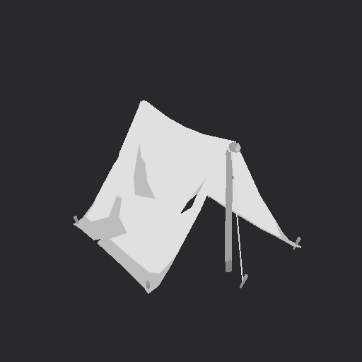

# Tente

`Assets/Prefabs/Camp/Tente.prefab` · [← liste des prefabs](README.md)

Tente du camp (Meadow Forest `SM_Prop_Camp_Tent_01`). Bloque sa case.



## Hiérarchie

```
Tente  [CampObstacle]
└─ Pièce
   └─ SM_Prop_Camp_Tent_01  [MeshFilter, MeshRenderer]
```

## Contenu

### Tente

- **CampObstacle**
  - `blocks` = oui — Coché : bloque la case. Décoché : décor de passage.

### Tente / Pièce

- **Transform**
  - position (0, 0.093, 0)
  - échelle (1.35, 1.35, 1.35)

### Tente / Pièce / SM_Prop_Camp_Tent_01

- **MeshFilter**
  - maillage `SM_Prop_Camp_Tent_01` (`Assets/Synty/PolygonNatureBiomes/PNB_Meadow_Forest/Models/SM_Prop_Camp_Tent_01.fbx`)
- **MeshRenderer**
  - matériaux `M_Toon_PolygonNatureBiomesMeadow_Mat_01` (Deckscent/Toon)
