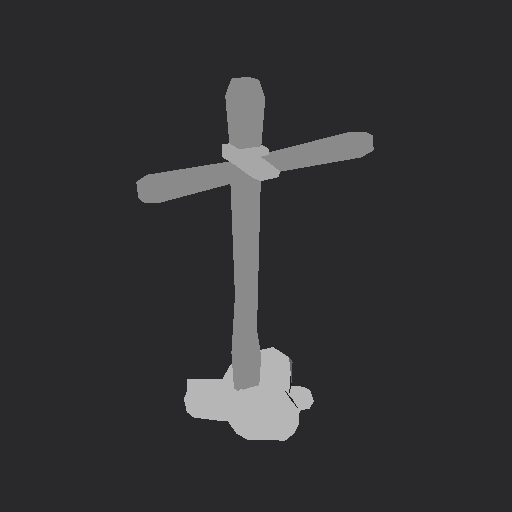

# Tombe

`Assets/Prefabs/Camp/Tombe.prefab` · [← liste des prefabs](README.md)

Tombe (Nature `SM_Prop_Grave_03`), au sud-ouest du camp.



## Hiérarchie

```
Tombe
└─ Pièce
   └─ SM_Prop_Grave_03  [MeshFilter, MeshRenderer]
```

## Contenu

### Tombe / Pièce / SM_Prop_Grave_03

- **MeshFilter**
  - maillage `SM_Prop_Grave_03` (`Assets/Synty/PolygonNature/Models/SM_Prop_Grave_03.fbx`)
- **MeshRenderer**
  - matériaux `M_Toon_PolygonNature_01` (Deckscent/Toon)
