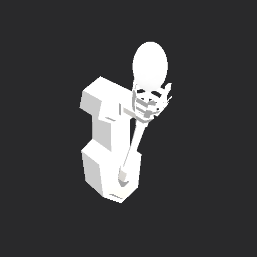

# Torche

`Assets/Prefabs/Maze/Torche.prefab` · [← liste des prefabs](README.md)

Torche murale, posée sur les cases `T`, accrochée au premier mur voisin. Sa racine est sur le mur, +Z vers la case.



## Hiérarchie

```
Torche
├─ Support
│  └─ Pièce
│     └─ SM_Prop_Torch_Ornate_02  [MeshFilter, MeshRenderer]
├─ Flamme
│  └─ Forme  [MeshFilter, MeshRenderer]
└─ Lumière  [Light, TorchFlicker]
```

## Contenu

### Torche / Support

- **Transform**
  - position (0, -0.2, 0.11)

### Torche / Support / Pièce / SM_Prop_Torch_Ornate_02

- **MeshFilter**
  - maillage `SM_Prop_Torch_Ornate_02` (`Assets/Synty/PolygonDungeon/Models/SM_Prop_Torch_Ornate_02.fbx`)
- **MeshRenderer**
  - matériaux `M_Toon_PolygonDungeon_01` (Deckscent/Toon)
  - ombres portées : Off

### Torche / Flamme / Forme

- **Transform**
  - position (0, 0.3, 0.48)
  - échelle (0.18, 0.26, 0.18)
- **MeshFilter**
  - maillage `Sphere` (`Library/unity default resources`)
- **MeshRenderer**
  - matériaux `M_Flamme` (Universal Render Pipeline/Unlit)
  - ombres portées : Off

### Torche / Lumière

- **Transform**
  - position (0, 0.3, 0.71)
- **Light**
  - Point, couleur (1, 0.97, 0.92), intensité 2.5, portée 9 m, ombres Hard
- **TorchFlicker**
  - `baseIntensity` = 2.5 — Intensité moyenne de la torche.
  - `flicker` = 0.35 — Amplitude du vacillement.
  - `howlReach` = 20 — Quand un loup-garou hurle à moins de cette distance (mètres), la flamme s'embrase un instant. 0 = jamais.
