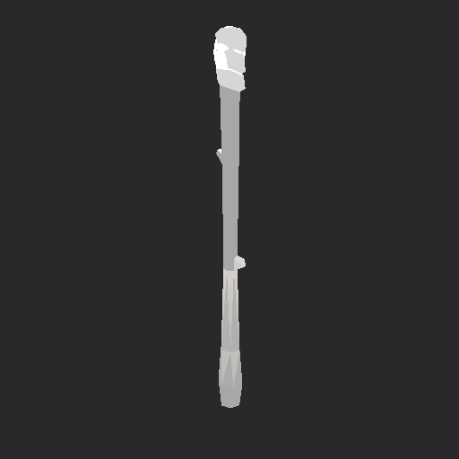

# TorchePieu

`Assets/Prefabs/Camp/TorchePieu.prefab` · [← liste des prefabs](README.md)

Torche plantée dans le sol (Nature `SM_Prop_TorchStick_01`), flamme blanche et lumière (2 / 8 m), de part et d'autre de l'entrée du donjon.



## Hiérarchie

```
TorchePieu
├─ Pieu
│  └─ Pièce
│     └─ SM_Prop_TorchStick_01  [MeshFilter, MeshRenderer]
├─ Flamme
│  └─ Forme  [MeshFilter, MeshRenderer]
└─ Lumière  [Light, TorchFlicker]
```

## Contenu

### TorchePieu / Pieu / Pièce

- **Transform**
  - position (0.001, 0.163, 0)
  - échelle (1.3, 1.3, 1.3)

### TorchePieu / Pieu / Pièce / SM_Prop_TorchStick_01

- **MeshFilter**
  - maillage `SM_Prop_TorchStick_01` (`Assets/Synty/PolygonNature/Models/SM_Prop_TorchStick_01.fbx`)
- **MeshRenderer**
  - matériaux `M_Toon_PolygonNature_01` (Deckscent/Toon)
  - ombres portées : Off

### TorchePieu / Flamme / Forme

- **Transform**
  - position (0, 2.3, 0)
  - échelle (0.18, 0.3, 0.18)
- **MeshFilter**
  - maillage `Sphere` (`Library/unity default resources`)
- **MeshRenderer**
  - matériaux `M_Flamme` (Universal Render Pipeline/Unlit)
  - ombres portées : Off

### TorchePieu / Lumière

- **Transform**
  - position (0, 2.4, 0)
- **Light**
  - Point, couleur (1, 0.97, 0.92), intensité 2, portée 8 m, ombres Hard
- **TorchFlicker**
  - `baseIntensity` = 2.5 — Intensité moyenne de la torche.
  - `flicker` = 0.35 — Amplitude du vacillement.
  - `howlReach` = 20 — Quand un loup-garou hurle à moins de cette distance (mètres), la flamme s'embrase un instant. 0 = jamais.
