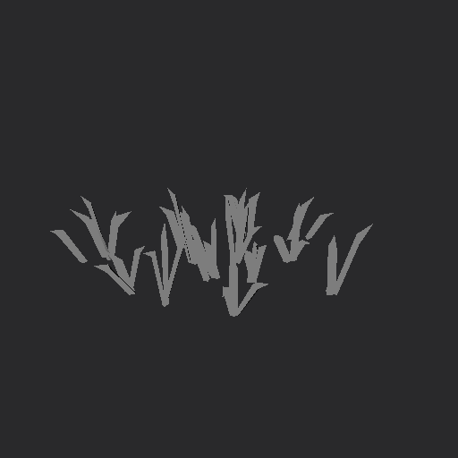

# Touffe_01

`Assets/Prefabs/Camp/Touffe_01.prefab` · [← liste des prefabs](README.md)

Petite touffe d'herbe (Farm), semée çà et là dans le camp.



## Hiérarchie

```
Touffe_01
└─ Pièce
   └─ SM_Generic_Grass_Patch_03  [MeshFilter, MeshRenderer]
```

## Contenu

### Touffe_01 / Pièce

- **Transform**
  - position (0.048, 0.04, 0.008)
  - échelle (0.25, 0.25, 0.25)

### Touffe_01 / Pièce / SM_Generic_Grass_Patch_03

- **MeshFilter**
  - maillage `SM_Generic_Grass_Patch_03` (`Assets/Synty/PolygonDungeonRealms/Models/SM_Generic_Grass_Patch_03.fbx`)
- **MeshRenderer**
  - matériaux `M_Toon_PolygonDungeonRealms_01_A` (Deckscent/Toon)
