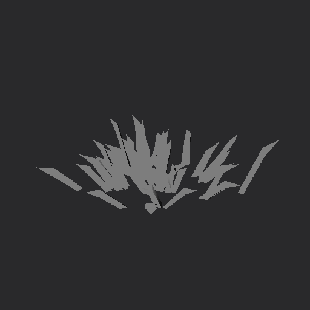

# Touffe_02

`Assets/Prefabs/Camp/Touffe_02.prefab` · [← liste des prefabs](README.md)

Petite touffe d'herbe (Farm), semée çà et là dans le camp.



## Hiérarchie

```
Touffe_02
└─ Pièce
   └─ SM_Generic_Grass_Patch_01  [MeshFilter, MeshRenderer]
```

## Contenu

### Touffe_02 / Pièce

- **Transform**
  - échelle (0.6, 0.6, 0.6)

### Touffe_02 / Pièce / SM_Generic_Grass_Patch_01

- **MeshFilter**
  - maillage `SM_Generic_Grass_Patch_01` (`Assets/Synty/PolygonDungeonRealms/Models/SM_Generic_Grass_Patch_01.fbx`)
- **MeshRenderer**
  - matériaux `M_Toon_PolygonDungeonRealms_01_A` (Deckscent/Toon)
