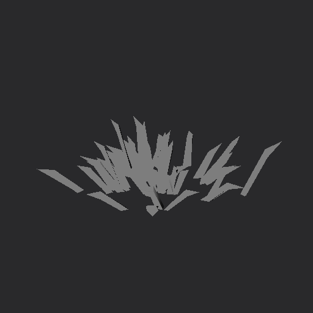

# Touffe_03

`Assets/Prefabs/Camp/Touffe_03.prefab` · [← liste des prefabs](README.md)



## Hiérarchie

```
Touffe_03
└─ Pièce
   └─ SM_Generic_Grass_Patch_01  [MeshFilter, MeshRenderer]
```

## Contenu

### Touffe_03 / Pièce / SM_Generic_Grass_Patch_01

- **MeshFilter**
  - maillage `SM_Generic_Grass_Patch_01` (`Assets/Synty/PolygonDungeonRealms/Models/SM_Generic_Grass_Patch_01.fbx`)
- **MeshRenderer**
  - matériaux `M_Toon_PolygonDungeonRealms_01_A` (Deckscent/Toon)
