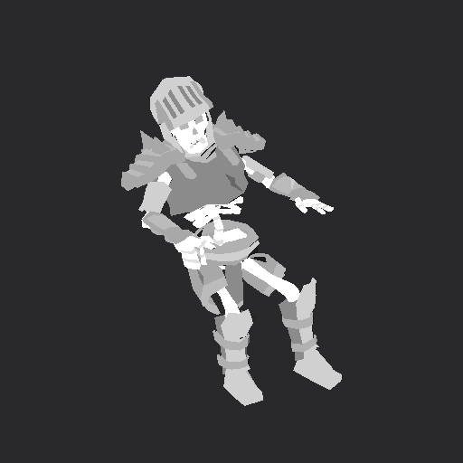

# Trone

`Assets/Prefabs/Props/Antre/Trone.prefab` · [← liste des prefabs](README.md)

Décor de l'antre du boss : trône (Synty `SM_Prop_Skeleton_Knight_Throne_01`) contre le mur le plus loin des portes ; le boss dort devant. Bloque sa case. Voir docs/antre.md.



## Hiérarchie

```
Trone  [DecorFallback, LairDecor]
├─ Décor
│  └─ Pièce
│     └─ SM_Prop_Skeleton_Knight_Throne_01  [MeshFilter, MeshRenderer]
└─ Secours
   ├─ Siège  [MeshFilter, MeshRenderer]
   └─ Dossier  [MeshFilter, MeshRenderer]
```

## Contenu

### Trone

- **DecorFallback**
  - `decor` = `Décor` — La pièce Synty (enfant).
  - `fallback` = `Secours` — La version en formes simples, affichée si le décor n'a pas ses maillages.
  - `forceFallback` = non — Coché : toujours le secours, même si le décor est là (pour comparer).
- **LairDecor**
  - `blocks` = oui — Coché : bloque la case (joueur, monstres, charge). Décoché : décor de passage (ossements au sol…).

### Trone / Décor / Pièce

- **Transform**
  - position (-0.01, 0.04, -0.201)
  - échelle (1.649, 1.649, 1.649)

### Trone / Décor / Pièce / SM_Prop_Skeleton_Knight_Throne_01

- **MeshFilter**
  - maillage `SM_Prop_Skeleton_Knight_Throne_01` (`Assets/Synty/PolygonDungeon/Models/SM_Prop_Skeleton_Knight_Throne_01.fbx`)
- **MeshRenderer**
  - matériaux `M_Toon_PolygonDungeon_01` (Deckscent/Toon)

### Trone / Secours / Siège

- **Transform**
  - position (0, 0.3, 0)
  - échelle (1.2, 0.6, 1)
- **MeshFilter**
  - maillage `Cube` (`Library/unity default resources`)
- **MeshRenderer**
  - matériaux `M_Toon_Gris_Antre` (Deckscent/Toon)

### Trone / Secours / Dossier

- **Transform**
  - position (0, 1.3, -0.4)
  - échelle (1.2, 2, 0.2)
- **MeshFilter**
  - maillage `Cube` (`Library/unity default resources`)
- **MeshRenderer**
  - matériaux `M_Toon_Gris_Antre` (Deckscent/Toon)
