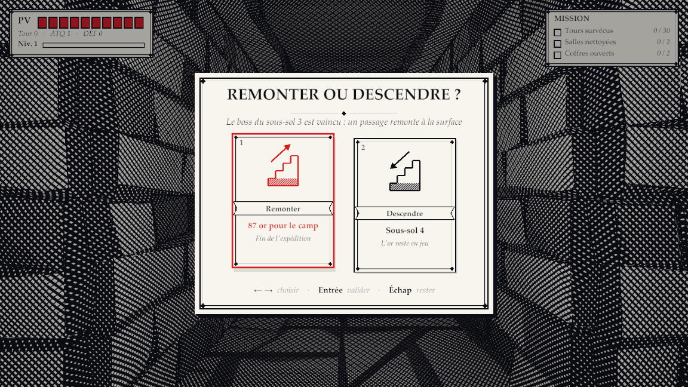
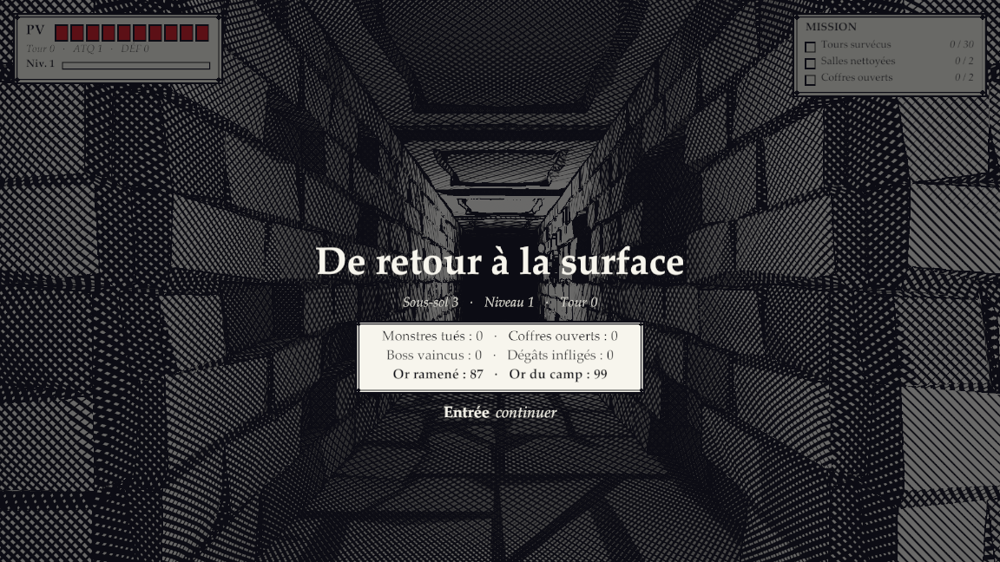

# Remontée

Décidé avec l'utilisateur le 2026-11-21 (GDD §2 et §6, voir [todo.md](todo.md)).

## Règles

- Les étages vont par **sous-biomes de 3** (`floorsPerSubBiome`, inspecteur du Donjon).
- Au **dernier étage d'un sous-biome** (sous-sols 3, 6, 9…), l'escalier ouvert par le boss propose un choix au lieu de descendre tout de suite :
  - **Remonter** : fin de l'expédition, **tout l'or porté** va au camp (voir [or.md](or.md)).
  - **Descendre** : on continue au sous-sol suivant, l'or reste en jeu (perdu à 90 % en cas de mort).
  - **Retour** (Échap / bouton droit) : ni l'un ni l'autre, on reste à l'étage, l'escalier reste ouvert.
- Ailleurs, l'escalier descend directement, comme avant.
- Boss prévus par étage du sous-biome : 1 loup-garou, 2 golem élémentaire, 3 Slayer (pour le moment, le loup-garou partout).

## Ce qu'on voit

1. **Le choix** (`AscentScreen`, prefab `UI/Remontee`) : le jeu se met en pause, deux cartes gravées (marches et flèche), « Remonter » avec l'or ramené, « Descendre » avec le sous-sol suivant. Souris, flèches / stick, chiffres 1-2, Entrée / bouton du bas.
2. **Le retour à la surface** (HUD) : voile d'encre, « De retour à la surface », le bilan de l'expédition (comme à la mort) et « Or ramené · Or du camp ». Entrée (ou bouton du bas, Échap) ramène à l'écran titre, en attendant le hub.

## Technique

- `Dungeon.IsSubBiomeEnd` : `Floor % floorsPerSubBiome == 0`.
- `Stairs.Interact` ouvre `AscentScreen` et attend son `Result` ; remonter appelle `Gold.EndOnReturn`, `Hud.ShowSurface`, fige le jeu (`Time.timeScale = 0`) et émet `Stairs.Ascended`.
- Écran construit par *Deckscent > Construire l'écran de remontée (prefab, scènes de jeu)* (`AscentBuilder`), ajouté à Main et Test_Donjon. La carte ne s'ouvre pas par-dessus (`AscentScreen.IsShown`), la pause non plus (jeu en pause).
- Tests : `BossTests.AuTroisiemeSousSolLEscalierProposeDeRemonterOuDeDescendre`, `BossTests.RemonterMetToutLOrALAbriEtFinitLExpedition`.
