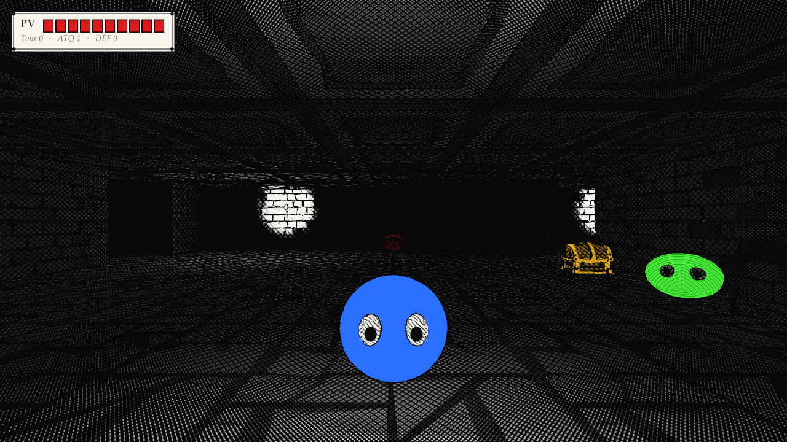

# Tour par tour et combat

Code : `Assets/Scripts/Player/PlayerController.cs` (tours, PV, attaque), `Assets/Scripts/Maze/GridEntity.cs` (ce qui joue après le joueur), `Assets/Scripts/Player/Combat.cs` (règle des dégâts), `Assets/Scripts/UI/Hud.cs` (interface). Tests : `Assets/Tests/PlayMode/CombatTests.cs`.

*Donjon de démo : un slime bleu droit devant, un coffre doré et un slime vert plus loin. Les accents (couleurs saturées) sortent du noir et blanc.*

## En bref

Le monde ne bouge que quand le joueur agit :

1. le joueur fait **une action** (un pas, une attaque, une attente, ouvrir un coffre) ;
2. son animation finie, **les monstres qui se déplacent bondissent tous en même temps**, puis **les attaques et les pièges** passent l'un après l'autre ;
3. le joueur peut rejouer.

| Action | Un tour ? |
|---|---|
| Un pas (avant, arrière, de côté) | oui |
| Avancer vers un ennemi droit devant = **l'attaquer** | oui |
| Avancer vers un coffre, ou **F** devant un coffre = **l'ouvrir** | oui |
| Attendre sur place (**Entrée**, L3) | oui |
| Tourner d'un quart de tour | **non** (réglable : `Turning Takes Turn`) |
| Se cogner à un mur, ou à un ennemi de côté / à reculons | non |
| Allumer / éteindre la lanterne | non |
| Ouvrir la carte, poser une tuile | non (le jeu est en pause) |

On a donc le temps de se tourner face à un monstre avant de frapper, et poser des tuiles ne donne pas de tour gratuit aux ennemis.

## Le combat

- **Attaquer** : avancer vers un ennemi juste devant. Petit élan, le coup part au bout de l'élan. Seulement **devant soi** : un ennemi sur le côté ou derrière, il faut d'abord se tourner (gratuit).
- **Dégâts** fixes, pas de hasard : `Attack` du joueur, `Damage` de l'ennemi.
- **Défense** : retirée des dégâts reçus, mais un coup qui porte fait **toujours au moins 1** (défense 1 contre 3 = 2, contre 1 = 1). Vaut aussi pour les pièges. Tout le monde a 0 par défaut (`Combat.DamageAfterDefense`).
- **Touché** : l'écran se voile de rouge et la caméra tremble.
- **Mort** : la caméra tombe au sol en basculant, l'écran s'assombrit, « Vous êtes mort ». Au bout d'une seconde, **Entrée** (ou F / bouton du bas) recharge la scène, **Échap** (ou Rond / B, action `UI/Cancel`) revient au menu. La carte ne s'ouvre plus.

Le comportement du slime est décrit dans [monstres/slime.md](monstres/slime.md), la dalle dans [pieges.md](pieges.md), le coffre dans [coffres.md](coffres.md).

## Le HUD

Prefab `Assets/Prefabs/UI/Hud.prefab` ([doc](prefabs/Hud.md)), dessiné en gravure comme la carte (`InkCanvas` + `TextPool`), dans toutes les scènes :

- en haut à gauche, un cartouche papier à double filet : **PV**, une case par point de vie (rouge pleine), et dessous **Tour N · ATQ · DÉF** ;
- en haut au centre, un **message** de 2 secondes quand il se passe quelque chose (« Piège franchi », « Coffre : +3 PV »…). N'importe quel script l'affiche avec `player.Notify(texte)` ;
- le voile rouge, l'écran de mort.

Canvas en surimpression (ordre 50, sous la carte à 100) : le post-process gravure ne le touche pas, d'où le rouge franc. Il tourne en temps réel (`unscaledDeltaTime`) : la pause de la carte ne le fige pas. Réglages : couleurs (papier, encre, rouge), `Hurt Flash` (0,35), `Toast Time` (1,8 s), `Restart Delay` (1 s). Textes traduits (`Loc`, option Langue du menu) : les messages aussi, traduits par le script qui appelle `Notify` (`Loc.T("Piège franchi")`).

## Réglages du joueur (prefab `Player`)

| Réglage | Défaut | Rôle |
|---|---|---|
| `Wait Time` | 0,25 s | Durée minimale d'une attente (sinon garder Entrée enfoncée ferait un tour par image). |
| `Turning Takes Turn` | non | Coché : tourner coûte un tour. |
| `Max Health` | 10 | PV au départ et maximum. |
| `Attack` | 1 | Dégâts d'une attaque. |
| `Defense` | 0 | Retirée des dégâts reçus (minimum 1 par coup). |
| `Interact` | `Player/Interact` | F, bouton du bas : ouvrir le coffre droit devant. |
| `Camera Rig` | `Caméra` | Ce qui tremble et tombe à la mort. |

## Comment ça marche

### La boucle des tours

Après chaque action qui compte, `PlayerController.EndTurn()` :

1. ajoute 1 à `Turn` ;
2. **déplacements** : demande à chaque objet de `GridEntity.All` où il veut aller (`PlanMove(player, casesPrises)`), les plus proches du joueur d'abord. Chacun réserve sa case : deux monstres ne finissent jamais sur la même case, et un monstre peut prendre celle que son voisin vient de quitter. Tous les bonds (`Move(case)`) sont joués **en même temps** ;
3. **tours** : appelle `TakeTurn(player)` sur ceux qui ne se sont pas déplacés (attaques, pièges, coffres), dans l'ordre d'apparition, l'un après l'autre, en attendant la fin de son animation ;
4. s'arrête net si le joueur meurt en route ;
5. émet `TurnEnded(turn)`.

Les coroutines des objets sont déroulées à la main (`Flatten`) : un objet qui n'a rien à faire ne coûte **aucune image**. Sans ça, chaque `yield return` d'une coroutine imbriquée coûtait une image, et un donjon de 40 objets bloquait le joueur plus d'une demi-seconde après chaque pas.

Pendant ce temps `IsBusy` bloque les touches. Un objet qui n'a rien à faire rend la main tout de suite. La carte ouverte met `Time.timeScale` à 0 : les animations (temps du jeu) attendent.

### Ajouter quelque chose qui joue à chaque tour

Hériter de `GridEntity` (`Assets/Scripts/Maze/GridEntity.cs`) :

- l'objet s'inscrit dans `GridEntity.All` en s'activant, en sort en se désactivant ;
- `Place(maze, case)` le pose (le Spawner l'appelle) ; `Cell` est sa case ;
- `PlanMove(player, casesPrises)` / `Move(case)` : son déplacement (joué en même temps que les autres) ; un objet qui se déplace ne joue pas `TakeTurn` ce tour-là ;
- `TakeTurn(player)` : son tour (une coroutine, qui peut animer), l'un après l'autre ; `player.TakeDamage(n)`, `player.Heal(n)`, `player.Notify(texte)` ;
- `BlocksPlayer` : le joueur ne peut pas entrer sur la case.

Un **ennemi** hérite d'`Enemy` (PV, attaque, défense, `TakeDamage`, `Died`) : avancer vers lui l'attaque. À sa mort, il **quitte tout de suite** `GridEntity.All` (`Retire()`) avant son animation : il ne joue plus et ne bloque plus. Un objet qu'on **ouvre** implémente `IInteractable` (`CanInteract`, `Interact(player)`) : avancer vers lui ou F l'actionne. Les ennemis passent avant : un slime sur un coffre se fait attaquer.

### Les événements du joueur

| Événement | Quand |
|---|---|
| `HealthChanged(pv, max)` | PV modifiés (et une fois au lancement). |
| `Hurt(dégâts)` | Le joueur vient d'être touché. |
| `Died` | PV à 0. |
| `TurnEnded(tour)` | Le monde a fini de jouer. |
| `Notified(texte)` | Un message pour le HUD. |

### Chemin des ennemis

`GridPath.Find(maze, de, vers, pasMax, casesBloquées)` (`Assets/Scripts/Enemies/GridPath.cs`) : plus court chemin en largeur d'abord, 4 directions, **murs fins des salles compris** (`Maze.CanStep`). Les cases prises (autres ennemis, cases déjà réservées ce tour) comptent comme des murs.
