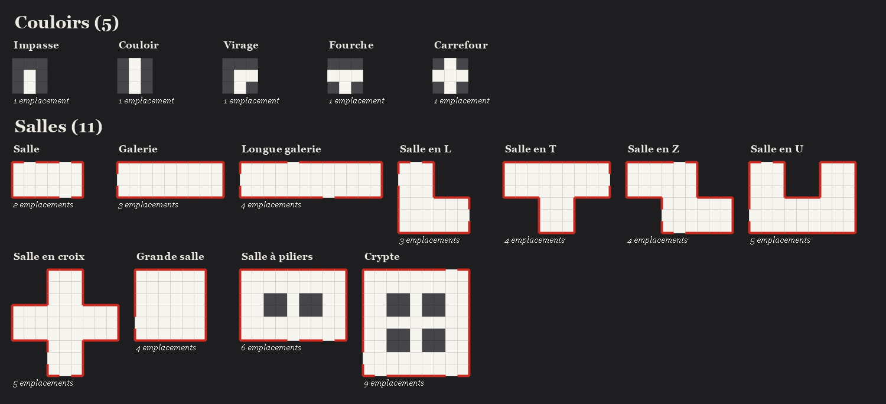
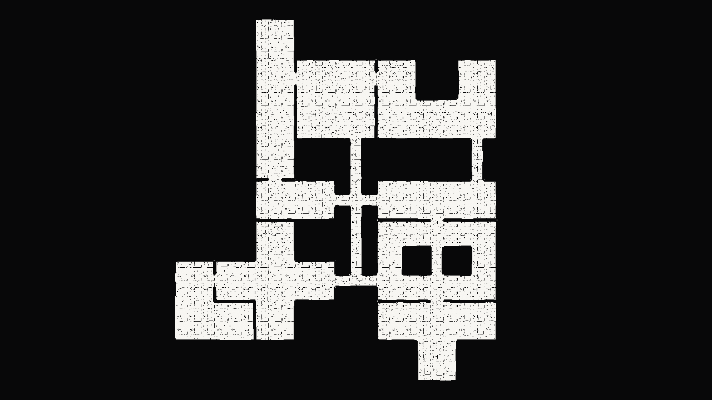

# Tuiles, salles et plateau

Le joueur construit son donjon en posant des **cartes-tuiles** sur un plateau. Code : `Assets/Scripts/Tiles/`, tests : `Assets/Tests/EditMode/TileTests.cs`.

**Rythme voulu** (façon donjon mystère) : on se balade longtemps dans des **couloirs étroits**, qui mettent la pression, et de loin en loin on tombe sur une **salle** : rare, mais dense et dangereuse (monstres, pièges, trésors).

## Les 16 tuiles

*Gris : roche. Blanc : sol (une case = 3 m). Rouge : murs fins des salles, troués aux portes (ici une donne fixe : les portes d'une vraie carte sont tirées au hasard). Orange : torche. Planche générée par* Deckscent > Planche des tuiles *(`TilePlate.cs` + `Tools/planche_tuiles.ps1`) : la relancer après avoir ajouté ou modifié une forme.*

*Le donjon de démo (`DemoDungeon`, scène `Test_Donjon`) : une salle de chaque sorte autour du carrefour de départ.*

## Le plateau

- Grille de **9 × 9 emplacements**. Un emplacement = **3 × 3 cases** du labyrinthe (une case = 3 m).
- **10 départs** (`DungeonBoard.Starters`), tirés au hasard à chaque partie. La première tuile du départ est celle où apparaît le joueur. Dans l'éditeur, l'objet *Donjon* de la scène Main montre les 10 départs côte à côte (`Starter Index` = -1) ou un seul.
- Après chaque pose, le plateau réécrit le plan du labyrinthe, qui se reconstruit.

## Les couloirs

Un emplacement, coins en mur, centre en sol, un passage possible au milieu de chaque côté.

| Forme | Passages (avant rotation) |
|---|---|
| Impasse | S |
| Couloir | N, S |
| Virage | E, S |
| Fourche | E, S, O |
| Carrefour | N, E, S, O |

## Les salles

Une salle couvre **plusieurs emplacements** et c'est une **vraie pièce** : tout l'intérieur est du sol. Son pourtour est fermé par des **murs fins**, posés sur les bords des cases, et percés de **1 à 3 portes** (4 pour les salles de 5 emplacements ou plus), tirées au hasard. Une porte est toujours au milieu d'un côté d'emplacement.

| Forme | Emplacements | Taille en cases |
|---|---|---|
| Salle | 2 × 1 | 6 × 3 |
| Galerie | 3 × 1 | 9 × 3 |
| Longue galerie | 4 × 1 | 12 × 3 |
| Salle en L | 3 en L | 6 × 6 moins un coin |
| Salle en T | 4 en T | 9 × 6 en T |
| Salle en Z | 4 en Z | 9 × 6 en Z |
| Salle en U | 5 en U | 9 × 6 en U |
| Salle en croix | 5 en croix | 9 × 9 en croix |
| Grande salle | 2 × 2 | 6 × 6 |
| Salle à piliers | 3 × 2 | 9 × 6, 2 piliers |
| Crypte | 3 × 3 | 9 × 9, 4 piliers |

Les **piliers** (salle à piliers, crypte) sont des blocs de 2 × 2 cases à chaque jonction de 4 emplacements.

La salle **garde sa forme** quoi qu'on pose autour : un couloir qui arrive face à un mur sans porte devient un cul-de-sac.

## La pioche

- **5 cartes en main** (6 au plus avec le butin d'un coffre). Une carte posée ou défaussée est remplacée.
- **Surtout des couloirs** : une carte tirée est une salle avec une chance de **20 %** (1 sur 5), et **6 salles au plus par étage** (posées + en main). Une fois le plafond atteint, la pioche ne donne plus que des couloirs : un étage a ainsi presque toujours 5 ou 6 salles.
- Parmi les salles, les grandes (U, croix, piliers, crypte) sont plus rares que les petites.
- Tout se règle dans l'inspecteur de l'objet *Donjon* (`Deck`) : `Room Chance`, `Max Rooms Per Floor`, poids des couloirs, des salles et des contenus.

## Le contenu

Chaque carte porte un **contenu**. Seul son **danger** (0 à 3 crânes) est affiché sur la carte : le joueur fait un pari. À la pose, le contenu **apparaît dans la tuile** (voir « Ce qui apparaît » plus bas) : monstre = un [slime](monstres/slime.md), piège = une [dalle à pics](pieges.md), trésor = un [coffre](coffres.md).

**Couloir** : un élément au plus, et le plus souvent rien.

| Contenu | Chance | Danger |
|---|---|---|
| Vide | 64 % | 0 |
| Monstre | 18 % | 2 |
| Piège | 14 % | 1 |
| Trésor | 5 % | 0 |

**Salle** : rare mais dense. Le nombre d'éléments dépend de la taille : petite (2 emplacements), moyenne (3-4), grande (5 et plus).

| Thème | Danger | Petite | Moyenne | Grande |
|---|---|---|---|---|
| Vide (rare) | 0 | rien | rien | rien |
| Trésor | 1 | 2 trésors | 2 trésors, 1 monstre | 3 trésors, 2 monstres |
| Pièges | 2 | 2 pièges | 3 pièges, 1 trésor | 4 pièges, 2 trésors |
| Piégée | 2 | 1 trésor, 2 pièges | 2 trésors, 3 pièges | 2 trésors, 3 pièges, 1 monstre |
| Gardée | 3 | 1 trésor, 2 monstres | 2 trésors, 3 monstres | 3 trésors, 4 monstres |
| Repaire | 3 | 3 monstres | 4 monstres, 1 trésor | 6 monstres, 1 trésor |

Le boss vient avec la mission de l'étage : une fois remplie, le jeu pose lui-même l'**antre du boss** (formes à part, `TileCard.BossShapeList`, jamais piochées), voir [antre.md](antre.md).

### Ce qui apparaît

Le **Spawner** (`Assets/Scripts/Tiles/Spawner.cs`, objet *Contenu* des scènes Main et Test_Donjon) suit les poses du plateau (`DungeonBoard.TilePlaced`) et fait apparaître la liste de la carte (`TileCard.SpawnList()`) :

- un élément par case de sol de la tuile, cases tirées au hasard, **jamais sur une porte** de salle (`DungeonBoard.TileFloorCells`) ;
- monstre : un slime vert, rouge ou bleu, à chances égales ; piège : une dalle, et les dalles d'une même tuile sont décalées (elles ne sortent pas au même tour) ; trésor : un coffre (son butin « carte » pioche dans la main du Donjon) ; boss : le loup-garou (dans l'antre, avec son décor, voir [antre.md](antre.md)) ; sanctuaire : une fontaine qui soigne (retirée de la pioche pour le moment, voir [decor.md](decor.md)) ;
- chaque élément est une **instance de son prefab** (`Prefabs/Enemies/Slime`, `Prefabs/Traps/DallePics`, `Prefabs/Props/Coffre`), enfant de l'objet *Contenu* ;
- chaque élément est **rattaché à sa tuile** (`Spawner.TileContents`, `ContentsOf(carte)`) : la tuile est nettoyée quand ses monstres sont morts et ses coffres ouverts, les dalles n'ont pas à être franchies (`TileCleared`, pour la [mission de l'étage](mission.md)) ;
- au lancement, les tuiles déjà posées sont remplies aussi : le **donjon de démo** (`Test_Donjon`) a du contenu sur ses tuiles (`DemoDungeon.Contents` : une dalle au nord du départ, un slime au sud, des salles de chaque thème) pour essayer combat, pièges et coffres sans rien poser ;
- tirages (cases, sorte de slime, décalage des dalles) avec un générateur à part (`seed` du Spawner, 0 = au hasard) : la pioche n'en dépend pas.

Aucun ennemi ni piège n'est posé à la main dans la scène de jeu. Réglages du Spawner : les trois prefabs, `Spawn On Place` (décoché : plus rien n'apparaît), `Seed`.

## Règles de pose

Volontairement permissives (`DungeonBoard.CheckPlacement`, qui renvoie la raison du refus) :

1. Tous les emplacements dans le plateau : sinon « Hors du plateau ».
2. Tous libres : sinon « Emplacement déjà occupé ».
3. La tuile touche le labyrinthe : sinon « Doit toucher le labyrinthe ».
4. Au moins un passage ou une porte raccordé à une tuile voisine : sinon « Doit se raccorder par un passage ».

Un passage qui donne sur un mur, sur le bord ou sur un emplacement vide devient un cul-de-sac : c'est au joueur de choisir s'il se bouche le chemin.

## Décor d'ambiance

Après son contenu, chaque tuile reçoit un peu de décor (vases et caisses à briser dans les coins des salles, statues, bougies, crânes, os) : voir [decor.md](decor.md).
